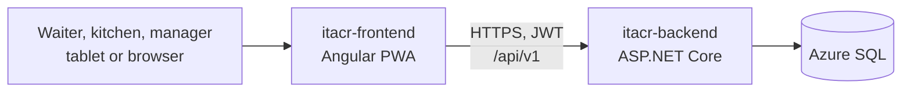
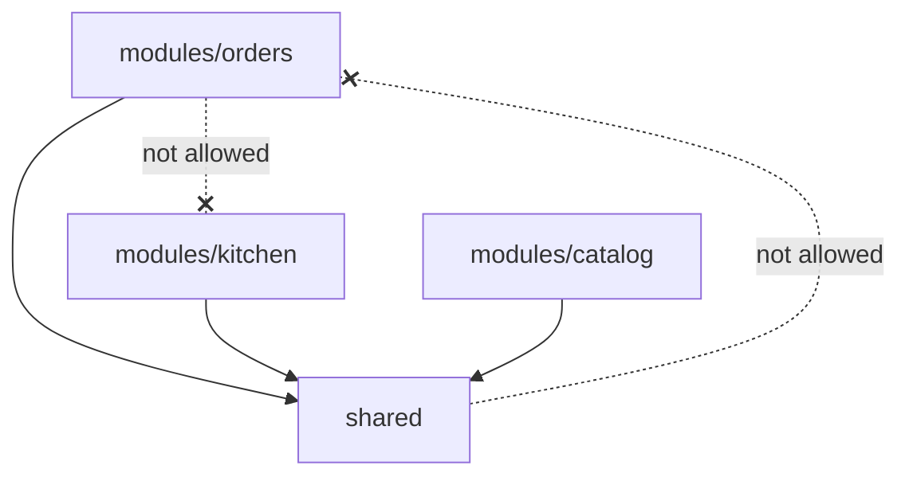
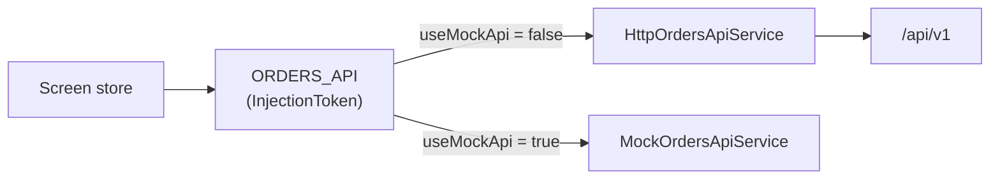

# Architecture: itacr-frontend

How the ITACR PWA is built and why. The day-to-day rules (naming, components, tests) live in [CODING_STANDARDS.md](CODING_STANDARDS.md); this document is the map.

## Table of contents

1. [System context](#1-system-context)
2. [Structure](#2-structure)
3. [Routing and roles](#3-routing-and-roles)
4. [State](#4-state)
5. [Talking to the API](#5-talking-to-the-api)
6. [PWA](#6-pwa)
7. [Testing strategy](#7-testing-strategy)
8. [Build and deployment](#8-build-and-deployment)
9. [Key decisions](#9-key-decisions)

## 1. System context



One installable PWA for every role. The screens a user sees depend on the role in their JWT.

## 2. Structure

```
src/app/
├── modules/<module>/<screen>/   # One lazy-loaded folder per screen
│   ├── pages/                   # Routed components
│   ├── components/              # Components used only by this screen
│   ├── services/                # API client (interface, HTTP, mock) and the screen store
│   ├── models/                  # Types and pure functions
│   └── <screen>.routes.ts       # Routes and their providers
└── shared/                      # Code used by more than one module
    ├── auth/  guards/  interceptors/
    ├── state/                   # Cross-screen state (order draft)
    ├── pipes/  components/  services/  mocks/  testing/
```



`eslint-plugin-boundaries` enforces the two rules (ITACR-39): **a module never imports another module, and `shared/` never imports a module.** When two modules need the same code, it moves to `shared/` (for example the order draft and the price pipe).

## 3. Routing and roles

| Path        | Module                              | Who              |
| ----------- | ----------------------------------- | ---------------- |
| `/`         | home                                | Everyone         |
| `/login`    | identity                            | Guests           |
| `/catalog`  | catalog                             | Everyone         |
| `/orders`   | orders (take order, summary, sent)  | Waiter           |
| `/kitchen`  | kitchen (board)                     | Kitchen, Manager |
| `/tracking` | tracking                            | Everyone         |
| `/pickup`   | orders (pickup order, confirmation) | Everyone         |
| `/manager`  | manager                             | Manager          |

- Every route is lazy-loaded, so the waiter flow downloads only what it uses.
- `roleGuard(...)` checks the role from the session. The backend checks it again on every endpoint; the guard only keeps the UI honest.

## 4. State

Signals, no state library.

| Scope     | Where                                                 | Example                                                                                                                                |
| --------- | ----------------------------------------------------- | -------------------------------------------------------------------------------------------------------------------------------------- |
| App       | `shared/` services `providedIn: 'root'`               | `SessionService` (token and employee), `OrderDraftService` (products the waiter picked, kept while moving between catalog and summary) |
| Screen    | A store `@Injectable()` provided in the route or page | `TakeOrderStore`, `KitchenStore`. They live while the screen is open, so leaving the kitchen board stops its polling                   |
| Component | `signal`, `computed`, `input`, `output`               | Local UI state                                                                                                                         |

Stores expose read-only signals and methods; components never write into another component's state.

## 5. Talking to the API

Every module defines its API the same way:



- `provide<Module>Api()` picks the HTTP or the mock implementation from `environment.useMockApi`, so a screen can be built before its endpoint exists. Production always uses HTTP.
- `authInterceptor` adds the JWT to API requests and, when a signed-in request gets a 401 (expired session), sends the user to the login page.
- Errors come as Problem Details. Stores map them to the Spanish messages of the screen (`take-order.messages.ts`); status 0 means no connection.
- Sending an order uses a `clientOrderId` made in the browser, so a retry after a network error never creates a second order.
- The kitchen board refreshes by polling every 5 s. Real time with SignalR comes in a later sprint (`environment.kitchenHubUrl`).

### Customer pickup orders (HU_06)

A customer without an account orders for pickup from the phone, and the backend decisions are in its `docs/ARCHITECTURE.md`, section 6.2 (ITACR-42). The frontend rules are:

- **Public routes, no guard:** `/`, `/login`, `/catalog`, `/pickup/**`, `/tracking/**`, and `/offline`. The pickup flow is `home` ("Ordenar para recoger") → `/catalog` → `/pickup/summary` (products, name and phone) → `/pickup/orders` (confirmation and status). It lives in `modules/orders` as its own screens and reuses the order draft in `shared/state` like the waiter flow. **It has its own lazy route entry** (`/pickup` in `app.routes.ts`, no guard) with its own routes file, API token (`providePickupApi()`), and checkout store (`PickupOrderStore`). The status screen has its own `PickupTrackingStore`, provided by the page so that leaving it stops the polling. It is never hung from `ORDERS_ROUTES`: `/orders` has `roleGuard(Waiter)` on the parent route, and `TakeOrderStore` belongs to the waiter flow (`provideOrdersApi()` is in root since HU_07, for the offline queue).
- **Data asked:** name (2 to 60 characters) and phone (exactly 10 digits). The form checks them before sending with the same rules as the backend and the Spanish message "Este campo es obligatorio.", but the server is the authority and its Problem Details errors are shown under the field.
- **Limits of the order:** at most 20 products and 10 units of each, like the backend. The catalog stops a customer at those numbers with a notice (`PICKUP_ORDER_LIMITS` in `shared/state/order-draft`), the stepper of the summary stops at 10, and sending is blocked with a Spanish message if the draft is over them anyway (the draft is shared with the waiter flow, which has no cap).
- **Idempotent send:** the browser generates the `clientOrderId` when the customer starts the order and keeps it until the server confirms, so a retry never creates a second order. A new order gets a new id.
- **Where the cart goes:** the catalog decides by session. A waiter goes to `/orders/summary`, a visitor without a session goes to `/pickup/summary`, and kitchen staff and managers get no cart.
- **The receipts:** the backend allows 2 active orders per phone, so the browser keeps a **list** of active receipts (at most 2), each with its `clientOrderId` and order number, in `localStorage`. A new order adds its receipt, and each receipt is dropped when its order is delivered (or the server answers `404` for it), so a second order never makes the customer lose track of the first. The name and the phone are **not** stored. The confirmation screen reads the list and asks `GET /public/orders/{clientOrderId}` for the status of each one (CA3 of HU_06).
- **Following the order:** the confirmation polls the status of each active receipt every 10 seconds while it is open and visible, and stops polling an order when it is delivered. One customer makes at most 12 requests per minute (2 receipts), under the limit of 60 per minute per IP, which several customers on the restaurant WiFi share.
- **Errors:** `429` shows "Demasiados intentos. Espera un momento e inténtalo de nuevo."; `409` shows the message of the server (an order already sent, or two active orders for that phone); status 0 shows the no-connection message.
- **No offline queue for customers.** Offline sending (HU_07) is only for the waiter flow. Without a connection the customer sees a clear message and the order is not queued.
- **No token on public calls:** requests to `/public/` do not carry the staff JWT, even when an employee is signed in on the same phone, so an expired token can never send a customer to the login page. This is a small change in `authInterceptor`, with its spec, in HU_06.
- **Service worker:** `/public/orders/**` is live data and is never cached, like `/kitchen`.

### Waiter orders without a connection (HU_07)

The waiter keeps sending orders when the restaurant WiFi drops; they reach the kitchen by themselves when it comes back. The backend rule (`createdAt`, 12-hour window) is in its `docs/ARCHITECTURE.md`.

- **When an order is queued:** `TakeOrderStore.send()` saves it on the device instead of calling the API when `ConnectionStatusService` reports offline, and also when the request fails with status 0 or takes more than 15 s (a WiFi without internet reports online). The waiter sees "Pedido guardado. Se enviará a cocina cuando vuelva la conexión." (CA1). If the device cannot store it, the order stays in the draft with an error.
- **The queue:** `OfflineOrdersService`, provided in root and started by an app initializer, so it syncs from any screen; that is why `provideOrdersApi()` is in `app.config.ts`. Each order is saved in IndexedDB (`itacr` database, `pending-orders` store, keyed by `clientOrderId`) with the full request, the waiter's id, and a summary for the dashboard. Without IndexedDB it falls back to memory.
- **Sync:** when the connection comes back, when the app starts, and every 30 s while orders are waiting. It sends the orders of the signed-in waiter one by one, oldest first, with their original `clientOrderId` and `createdAt`, so the kitchen gets them in their original place and never twice (CA2, CA3). One sync runs at a time. A network error, a timeout, `401`, `429` or `5xx` stops it until the next try; any other `4xx` (an order more than 12 hours old, a product no longer on the menu) marks the order "No se pudo enviar" and the waiter can discard it. No Background Sync: orders go out while the app is open.
- **One waiter per order:** an order is only sent with the session of the waiter who took it, so another waiter on the same device never sends it as theirs. Logging out with unsent orders asks for confirmation and keeps them for that waiter's next sign-in. With an expired session nothing is sent until the waiter signs in again.
- **What the waiter sees:** the dashboard always shows the connection and how many orders are waiting, plus the list of unsent orders (pending or rejected). Pending orders are not in the kitchen. When the connection drops, a native modal `<dialog>` ("Sin conexión", "Continuar sin conexión") opens over the current screen, so the waiter stays where they were (CA4); it closes by itself when the connection comes back. It is not `MatDialog`, which would pull the CDK overlay into the initial bundle.
- **Tables offline:** `GET /dining-tables` is cached by the service worker (`dining-tables` data group, freshness), so a table can be picked without a connection. The catalog was already cached.

## 6. PWA

- Angular service worker (`ngsw-config.json`): the app shell is cached, so the app opens without a connection.
- `AppUpdateService` checks for new versions and offers a reload in a snack bar.
- Installable from the manifest in `public/`.
- Production builds use `index.production.html`, which adds the Content Security Policy.

## 7. Testing strategy

- Vitest through the Angular builder, specs next to the code (`*.spec.ts`), Arrange-Act-Assert, names like "should … when …".
- Stores are tested with a fake API behind the injection token; pages through the DOM (buttons, `role="alert"`, `data-testid`); HTTP services with `HttpTestingController`.
- CI runs lint (ESLint, boundaries, template accessibility), Prettier, the tests, and the production build on every PR.

## 8. Build and deployment

- `environment.ts` (production) and `environment.development.ts` hold the API URL, the SignalR hub URL, the VAPID key, and `useMockApi`. They are build-time values, not secrets.
- The deploy workflow runs on `main`: tests, production build, and publish to Azure App Service. release-please versions the app and writes the CHANGELOG.

## 9. Key decisions

| Decision                                                             | Instead of                                      | Why                                                                      |
| -------------------------------------------------------------------- | ----------------------------------------------- | ------------------------------------------------------------------------ |
| `modules/` + `shared/` with lint boundaries (ITACR-39)               | Folders by technical type                       | A story stays inside one module; coupling between modules fails the lint |
| Standalone components and signals                                    | NgModules, NgRx                                 | Less code for the size of the app; fine-grained updates                  |
| Store per screen, provided in the route                              | Global store                                    | State is created and destroyed with the screen                           |
| API behind an injection token with a mock                            | Calling `HttpClient` from components            | Screens can be built and tested before the endpoint exists               |
| Polling for the kitchen board (ITACR-10)                             | SignalR now                                     | Simple and reliable for sprint 2; SignalR is planned                     |
| Receipts (up to 2) in `localStorage`, no customer account (ITACR-42) | Accounts, or name and phone stored in the phone | Nothing to protect or reset; personal data never stays on the device     |
