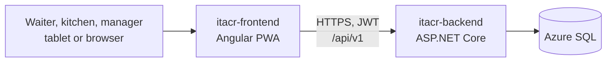
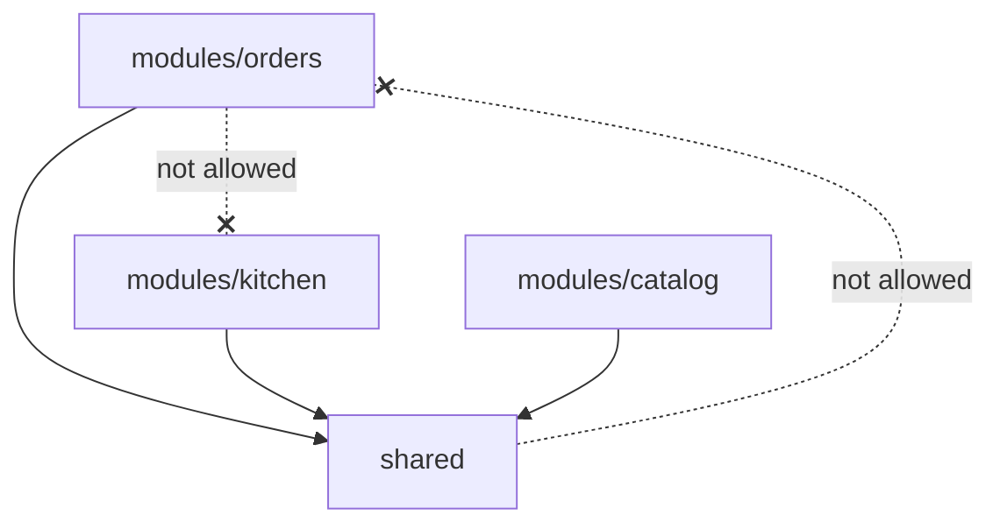
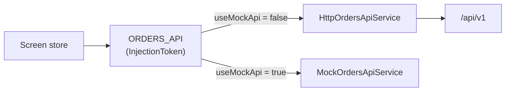

# Architecture: itacr-frontend

How the ITACR PWA is built and why. The day-to-day rules (naming, components, tests) live in [CODING_STANDARDS.md](CODING_STANDARDS.md); this document is the map.

## Table of contents

1. [System context](#1-system-context)
2. [Structure](#2-structure)
3. [Routing and roles](#3-routing-and-roles)
4. [State](#4-state)
5. [Talking to the API](#5-talking-to-the-api)
6. [PWA](#6-pwa)
7. [Testing strategy](#7-testing-strategy)
8. [Build and deployment](#8-build-and-deployment)
9. [Key decisions](#9-key-decisions)

## 1. System context



One installable PWA for every role. The screens a user sees depend on the role in their JWT.

## 2. Structure

```
src/app/
├── modules/<module>/<screen>/   # One lazy-loaded folder per screen
│   ├── pages/                   # Routed components
│   ├── components/              # Components used only by this screen
│   ├── services/                # API client (interface, HTTP, mock) and the screen store
│   ├── models/                  # Types and pure functions
│   └── <screen>.routes.ts       # Routes and their providers
└── shared/                      # Code used by more than one module
    ├── auth/  guards/  interceptors/
    ├── state/                   # Cross-screen state (order draft)
    ├── pipes/  components/  services/  mocks/  testing/
```



`eslint-plugin-boundaries` enforces the two rules (ITACR-39): **a module never imports another module, and `shared/` never imports a module.** When two modules need the same code, it moves to `shared/` (for example the order draft and the price pipe).

## 3. Routing and roles

| Path        | Module                             | Who              |
| ----------- | ---------------------------------- | ---------------- |
| `/`         | home                               | Everyone         |
| `/login`    | identity                           | Guests           |
| `/catalog`  | catalog                            | Everyone         |
| `/orders`   | orders (take order, summary, sent) | Waiter           |
| `/kitchen`  | kitchen (board)                    | Kitchen, Manager |
| `/tracking` | tracking                           | Everyone         |
| `/manager`  | manager                            | Manager          |

- Every route is lazy-loaded, so the waiter flow downloads only what it uses.
- `roleGuard(...)` checks the role from the session. The backend checks it again on every endpoint; the guard only keeps the UI honest.

## 4. State

Signals, no state library.

| Scope     | Where                                                 | Example                                                                                                                                |
| --------- | ----------------------------------------------------- | -------------------------------------------------------------------------------------------------------------------------------------- |
| App       | `shared/` services `providedIn: 'root'`               | `SessionService` (token and employee), `OrderDraftService` (products the waiter picked, kept while moving between catalog and summary) |
| Screen    | A store `@Injectable()` provided in the route or page | `TakeOrderStore`, `KitchenStore`. They live while the screen is open, so leaving the kitchen board stops its polling                   |
| Component | `signal`, `computed`, `input`, `output`               | Local UI state                                                                                                                         |

Stores expose read-only signals and methods; components never write into another component's state.

## 5. Talking to the API

Every module defines its API the same way:



- `provide<Module>Api()` picks the HTTP or the mock implementation from `environment.useMockApi`, so a screen can be built before its endpoint exists. Production always uses HTTP.
- `authInterceptor` adds the JWT to API requests and, when a signed-in request gets a 401 (expired session), sends the user to the login page.
- Errors come as Problem Details. Stores map them to the Spanish messages of the screen (`take-order.messages.ts`); status 0 means no connection.
- Sending an order uses a `clientOrderId` made in the browser, so a retry after a network error never creates a second order.
- The kitchen board refreshes by polling every 5 s. Real time with SignalR comes in a later sprint (`environment.kitchenHubUrl`).

## 6. PWA

- Angular service worker (`ngsw-config.json`): the app shell is cached, so the app opens without a connection.
- `AppUpdateService` checks for new versions and offers a reload in a snack bar.
- Installable from the manifest in `public/`.
- Production builds use `index.production.html`, which adds the Content Security Policy.

## 7. Testing strategy

- Vitest through the Angular builder, specs next to the code (`*.spec.ts`), Arrange-Act-Assert, names like "should … when …".
- Stores are tested with a fake API behind the injection token; pages through the DOM (buttons, `role="alert"`, `data-testid`); HTTP services with `HttpTestingController`.
- CI runs lint (ESLint, boundaries, template accessibility), Prettier, the tests, and the production build on every PR.

## 8. Build and deployment

- `environment.ts` (production) and `environment.development.ts` hold the API URL, the SignalR hub URL, the VAPID key, and `useMockApi`. They are build-time values, not secrets.
- The deploy workflow runs on `main`: tests, production build, and publish to Azure App Service. release-please versions the app and writes the CHANGELOG.

## 9. Key decisions

| Decision                                               | Instead of                           | Why                                                                      |
| ------------------------------------------------------ | ------------------------------------ | ------------------------------------------------------------------------ |
| `modules/` + `shared/` with lint boundaries (ITACR-39) | Folders by technical type            | A story stays inside one module; coupling between modules fails the lint |
| Standalone components and signals                      | NgModules, NgRx                      | Less code for the size of the app; fine-grained updates                  |
| Store per screen, provided in the route                | Global store                         | State is created and destroyed with the screen                           |
| API behind an injection token with a mock              | Calling `HttpClient` from components | Screens can be built and tested before the endpoint exists               |
| Polling for the kitchen board (ITACR-10)               | SignalR now                          | Simple and reliable for sprint 2; SignalR is planned                     |
