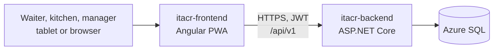
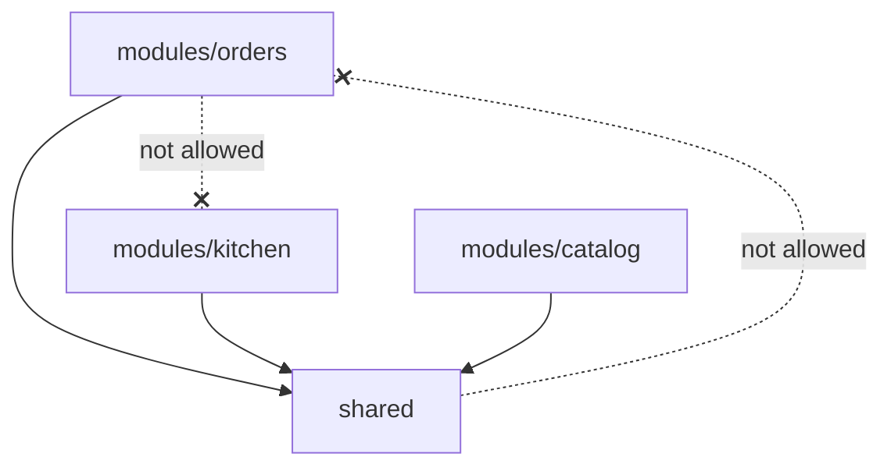
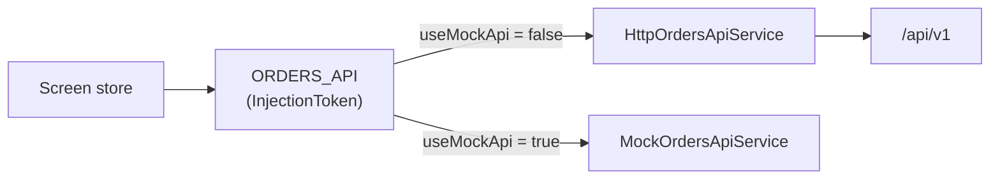

# Architecture: itacr-frontend

How the ITACR PWA is built and why. The day-to-day rules (naming, components, tests) live in [CODING_STANDARDS.md](CODING_STANDARDS.md); this document is the map.

## Table of contents

1. [System context](#1-system-context)
2. [Structure](#2-structure)
3. [Routing and roles](#3-routing-and-roles)
4. [State](#4-state)
5. [Talking to the API](#5-talking-to-the-api)
6. [PWA](#6-pwa)
7. [Testing strategy](#7-testing-strategy)
8. [Build and deployment](#8-build-and-deployment)
9. [Key decisions](#9-key-decisions)

## 1. System context



One installable PWA for every role. The screens a user sees depend on the role in their JWT.

## 2. Structure

```
src/app/
├── modules/<module>/<screen>/   # One lazy-loaded folder per screen
│   ├── pages/                   # Routed components
│   ├── components/              # Components used only by this screen
│   ├── services/                # API client (interface, HTTP, mock) and the screen store
│   ├── models/                  # Types and pure functions
│   └── <screen>.routes.ts       # Routes and their providers
└── shared/                      # Code used by more than one module
    ├── auth/  guards/  interceptors/
    ├── state/                   # Cross-screen state (order draft)
    ├── pipes/  components/  services/  mocks/  testing/
```



`eslint-plugin-boundaries` enforces the two rules (ITACR-39): **a module never imports another module, and `shared/` never imports a module.** When two modules need the same code, it moves to `shared/` (for example the order draft and the price pipe).

## 3. Routing and roles

| Path        | Module                              | Who                        |
| ----------- | ----------------------------------- | -------------------------- |
| `/`         | home                                | Everyone                   |
| `/login`    | identity                            | Guests                     |
| `/catalog`  | catalog                             | Everyone                   |
| `/orders`   | orders (take order, summary, sent)  | Waiter                     |
| `/kitchen`  | kitchen (board)                     | Kitchen, Manager           |
| `/tracking` | tracking                            | Everyone                   |
| `/pickup`   | orders (pickup order, confirmation) | Everyone, planned in HU_06 |
| `/manager`  | manager                             | Manager                    |

- Every route is lazy-loaded, so the waiter flow downloads only what it uses.
- `roleGuard(...)` checks the role from the session. The backend checks it again on every endpoint; the guard only keeps the UI honest.

## 4. State

Signals, no state library.

| Scope     | Where                                                 | Example                                                                                                                                |
| --------- | ----------------------------------------------------- | -------------------------------------------------------------------------------------------------------------------------------------- |
| App       | `shared/` services `providedIn: 'root'`               | `SessionService` (token and employee), `OrderDraftService` (products the waiter picked, kept while moving between catalog and summary) |
| Screen    | A store `@Injectable()` provided in the route or page | `TakeOrderStore`, `KitchenStore`. They live while the screen is open, so leaving the kitchen board stops its polling                   |
| Component | `signal`, `computed`, `input`, `output`               | Local UI state                                                                                                                         |

Stores expose read-only signals and methods; components never write into another component's state.

## 5. Talking to the API

Every module defines its API the same way:



- `provide<Module>Api()` picks the HTTP or the mock implementation from `environment.useMockApi`, so a screen can be built before its endpoint exists. Production always uses HTTP.
- `authInterceptor` adds the JWT to API requests and, when a signed-in request gets a 401 (expired session), sends the user to the login page.
- Errors come as Problem Details. Stores map them to the Spanish messages of the screen (`take-order.messages.ts`); status 0 means no connection.
- Sending an order uses a `clientOrderId` made in the browser, so a retry after a network error never creates a second order.
- The kitchen board refreshes by polling every 5 s. Real time with SignalR comes in a later sprint (`environment.kitchenHubUrl`).

### Customer pickup orders (HU_06)

A customer without an account orders for pickup from the phone, and the backend decisions are in its `docs/ARCHITECTURE.md`, section 6.2 (ITACR-42). The frontend rules are:

- **Public routes, no guard:** `/`, `/login`, `/catalog`, `/pickup/**`, `/tracking/**`, and `/offline`. The pickup flow is `home` ("Ordenar para recoger") → `/catalog` → summary and customer data → confirmation. It lives in `modules/orders` as its own screens, never inside the waiter screens, and reuses the order draft in `shared/state` like the waiter flow.
- **Data asked:** name (2 to 60 characters) and phone (exactly 10 digits). The form checks them before sending with the same rules as the backend and the Spanish message "Este campo es obligatorio.", but the server is the authority and its Problem Details errors are shown under the field.
- **Idempotent send:** the browser generates the `clientOrderId` when the customer starts the order and keeps it until the server confirms, so a retry never creates a second order. A new order gets a new id.
- **The receipt:** after a successful send the browser stores only the `clientOrderId` and the order number in `localStorage`. The name and the phone are **not** stored. The confirmation screen reads the receipt and asks `GET /public/orders/{clientOrderId}` for the status (CA3 of HU_06).
- **Following the order:** the confirmation polls the status every 10 seconds while it is open and visible, and stops when the order is delivered. One customer makes 6 requests per minute, well under the limit of 60 per minute per IP, which several customers on the restaurant WiFi share.
- **Errors:** `429` shows "Demasiados intentos. Espera un momento e inténtalo de nuevo."; `409` shows the message of the server (an order already sent, or two active orders for that phone); status 0 shows the no-connection message.
- **No offline queue for customers.** Offline sending (HU_07) is only for the waiter flow. Without a connection the customer sees a clear message and the order is not queued.
- **No token on public calls:** requests to `/public/` do not carry the staff JWT, even when an employee is signed in on the same phone, so an expired token can never send a customer to the login page. This is a small change in `authInterceptor`, with its spec, in HU_06.
- **Service worker:** `/public/orders/**` is live data and is never cached, like `/kitchen`.

## 6. PWA

- Angular service worker (`ngsw-config.json`): the app shell is cached, so the app opens without a connection.
- `AppUpdateService` checks for new versions and offers a reload in a snack bar.
- Installable from the manifest in `public/`.
- Production builds use `index.production.html`, which adds the Content Security Policy.

## 7. Testing strategy

- Vitest through the Angular builder, specs next to the code (`*.spec.ts`), Arrange-Act-Assert, names like "should … when …".
- Stores are tested with a fake API behind the injection token; pages through the DOM (buttons, `role="alert"`, `data-testid`); HTTP services with `HttpTestingController`.
- CI runs lint (ESLint, boundaries, template accessibility), Prettier, the tests, and the production build on every PR.

## 8. Build and deployment

- `environment.ts` (production) and `environment.development.ts` hold the API URL, the SignalR hub URL, the VAPID key, and `useMockApi`. They are build-time values, not secrets.
- The deploy workflow runs on `main`: tests, production build, and publish to Azure App Service. release-please versions the app and writes the CHANGELOG.

## 9. Key decisions

| Decision                                                  | Instead of                                      | Why                                                                      |
| --------------------------------------------------------- | ----------------------------------------------- | ------------------------------------------------------------------------ |
| `modules/` + `shared/` with lint boundaries (ITACR-39)    | Folders by technical type                       | A story stays inside one module; coupling between modules fails the lint |
| Standalone components and signals                         | NgModules, NgRx                                 | Less code for the size of the app; fine-grained updates                  |
| Store per screen, provided in the route                   | Global store                                    | State is created and destroyed with the screen                           |
| API behind an injection token with a mock                 | Calling `HttpClient` from components            | Screens can be built and tested before the endpoint exists               |
| Polling for the kitchen board (ITACR-10)                  | SignalR now                                     | Simple and reliable for sprint 2; SignalR is planned                     |
| Receipt in `localStorage`, no customer account (ITACR-42) | Accounts, or name and phone stored in the phone | Nothing to protect or reset; personal data never stays on the device     |
